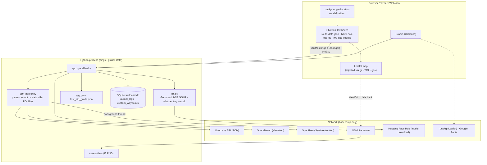
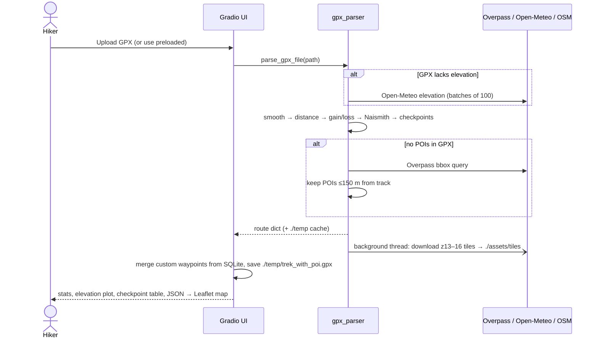
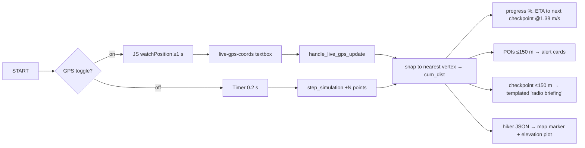

# Trailhead — Project Status Report, Technical Reference & Roadmap

| | |
|---|---|
| **Repository** | `xandie985/TrailHead` (branch `main`, last commit 2026-06-16, 53 commits, 1 contributor) |
| **Report date** | 2026-10-08 |
| **Purpose** | Baseline for adding features/enhancements and producing an Android APK |
| **How this was produced** | Full read of all Python/JS/CSS source, plus a scratch-venv run of the app (Gradio 6.18.0 on Python 3.13). Items marked **[verified]** were executed; items marked **[read]** come from reading code only. |

---

## 1. Executive summary

Trailhead is a single-process **Python/Gradio web app** that acts as a "trail computer": it ingests a GPX route, computes distance/elevation/Naismith time, shows the route and POIs on a Leaflet map, tracks a hiker (simulated playback or browser GPS), answers wilderness/first-aid questions with a local LLM + keyword RAG, and keeps a geotagged voice journal that can be turned into a trek story.

**Overall state: a working hackathon-grade prototype (v0.1).** The core planner, HUD, simulation, SQLite persistence and first-aid search work end to end **[verified]** with the bundled Trento route. The AI features (LLM, ASR) fall back to canned "mock" output when the native models are missing, and several headline claims in the README ("offline-first", "Gemma-4", LLM-narrated checkpoints, audio alerts) are **not yet true** in the code.

| Area | Status | Notes |
|---|---|---|
| GPX ingest, stats, smoothing, Naismith | ✅ Working **[verified]** | 3.49 km / 380 m gain / 252 pts / 5 checkpoints / 4 POIs on bundled route |
| POI fetch (Overpass) + 150 m buffer | ✅ Working **[read]**, needs network | Bundled route uses a pre-baked cache |
| Map + route + POI markers (Leaflet) | ✅ Working **[verified]** page serves | Leaflet JS/CSS loaded from unpkg CDN → online only |
| **Offline map tiles** | ❌ **Broken** **[verified]** | 43 tiles bundled, but the URL the map requests returns **404** (see D2) |
| Simulation player / HUD / proximity alerts | ✅ Working **[read]** | Visual only; no audio despite README |
| Live GPS (browser Geolocation) | 🟡 Implemented **[read]**, not testable headless | Needs HTTPS/localhost; foreground only |
| Custom waypoint tagging (SQLite) | 🟡 Works, but **"Clear" crashes** **[verified]** (D1) | |
| First-aid RAG (keyword) | ✅ Works **[verified]** | Only 5 manual sections |
| Chat / Guide LLM (llama.cpp, gemma-1.1-2b) | 🟡 **[read]** | Not run here (no model/llama-cpp). Silently degrades to canned mock replies |
| Voice journal ASR (whisper.cpp tiny) | 🟡 **[read]** | Same: falls back to canned transcript text |
| Story generator | 🟡 **[read]** | Real LLM or regex-driven mock template |
| Tests / CI | ❌ None | 3 ad-hoc scripts in `scratch/`, one with a hard-coded Windows path |
| Android APK | ❌ None | Only a Termux how-to in the README |
| Packaging/deploy | 🟡 | HF Space front-matter and Dockerfile were removed from the repo |

**Top-line recommendations**

1. Fix the 6 concrete defects in §8 (≈1 day) — one of them makes the first-aid tool unsafe when the LLM is absent.
2. Make "offline" real: self-host Leaflet/fonts/tiles and fix tile serving (≈1–2 days).
3. For the APK: a Gradio server cannot simply be "wrapped" and stay offline. Recommended path is a **staged approach** (§10): a quick Capacitor/TWA demo APK first, then a client-side re-architecture (Leaflet + local DB + on-device LLM/ASR plugins) for the true offline APK.

---

## 2. Repository inventory

```
TrailHead/
├── app.py                    1,816 lines  Gradio UI, all callbacks, embedded 380-line Leaflet JS bridge
├── src/
│   ├── gpx_parser.py           622        GPX parse, elevation fetch/smooth, POIs (Overpass), checkpoints, tile downloader
│   ├── llm.py                  566        llama.cpp loader, whisper.cpp/transformers ASR, mock generator, streaming
│   ├── rag.py                   81        keyword-overlap retriever over first_aid_guide.json
│   ├── database.py             120        SQLite: journal_logs, custom_waypoints
│   └── data/
│       ├── first_aid_guide.json          5 sections of wilderness first-aid text
│       └── trento_route_cache.json       pre-parsed bundled route (points, checkpoints, 4 POIs)
├── Routes/track_5-14724236830.gpx        bundled Trento loop (3.49 km) + Routes/cache/*.json
├── assets/custom.css         176          "tactical HUD" amber/dark theme (imports Google Fonts)
├── assets/tiles/{13,14,15}/…             43 OSM PNG tiles around the Trento route (1.4 MB)
├── media/                                README screenshots/GIFs (28 MB — dominates the repo)
├── scratch/test_*.py, test_overpass.py   manual scripts, not a test suite
├── requirements.txt
└── README.md                             (no LICENSE file, though README links one)
```

**Stack:** Python 3.11+ · Gradio 6.18 · gpxpy · folium (legacy path) · Plotly · pandas · requests · SQLite3 · llama-cpp-python 0.2.79 · pywhispercpp + miniaudio · Leaflet 1.9.4 (CDN) · Open-Meteo (elevation) · OSM Overpass (POIs) · OpenRouteService (optional routing).

---

## 3. Architecture



**Key architectural characteristics**

- **Server-rendered UI, client-side map.** Python never draws the live map; it pushes JSON into hidden textboxes whose `.change` events call JS handlers (`routeDataChangeHandler`, `updateHikerPosHandler`) defined in `MAP_INIT_JS` (`app.py:26-440`). This avoids iframe flicker but couples the app tightly to Gradio's DOM.
- **GPS is browser-side**: JS writes `{lat,lon,ele,acc}` into `#live-gps-coords` → Python callback `handle_live_gps_update` recomputes HUD/alerts and returns hiker JSON → map marker. Every GPS fix is a server round-trip.
- **Global, single-user state.** One SQLite file (`./trailhead.db`, relative path), one global `_llama_model` behind a lock, one `./temp/` dir. Per-session state is only `gr.State` (route, point index).
- **Graceful-degradation chain** (LLM): `llama_cpp` → on any failure/timeout → `generate_mock` (canned text). ASR: whisper.cpp → transformers Whisper → canned transcript.

---

## 4. Component reference

### 4.1 `src/gpx_parser.py` — deterministic engine
| Function | What it does |
|---|---|
| `parse_gpx_file` | Reads tracks → routes → waypoints (first non-empty). Fetches elevation from Open-Meteo **only if no point has elevation**; smooths (5-pt moving average); builds cumulative haversine distance; gain/loss with 2 m hysteresis; Naismith `km/5 + gain/600`; `estimated_days = max(1, hours/8)`. Caches result as `./temp/<name>.cache.json` **keyed by filename only**. Kicks off background tile download. |
| `extract_pois_from_gpx` | Reads POIs from `<wpt>` (type parsed from `"Type: …"` description or guessed from name) and `<extensions><poi …>` on track points. |
| `fetch_overpass_pois` / `filter_pois_near_track` | Overpass bbox query (water, spring, fountain, huts, camp, shelter, viewpoint, peak, phone), then O(P×N) haversine filter to 150 m. |
| `generate_checkpoints` | Start, every 1 km, End — or, if the GPX has waypoints, those snapped to the track. |
| `download_tiles_for_bbox` | Zoom 13–16 (13–15 if >120 tiles), 0.05 s delay, OSM User-Agent. |
| `save_enhanced_gpx` | Writes POIs back as `<wpt>` + track-point `<extensions>` → `./temp/trek_with_poi.gpx`. |

### 4.2 `app.py` — UI + orchestration
- **Tab 1 – Trek Planner & HUD:** route dropdown (1 preloaded) + GPX upload, GPS toggle, ▶/⏸/🔄 controls, speed slider, proximity alerts, custom-waypoint accordion, stats cards, Leaflet map, Plotly elevation profile, checkpoint table.
- **Tab 2 – Wilderness Guide:** `gr.ChatInterface(respond)` + static Emergency Card + manual quick-search.
- **Tab 3 – Voice Journal & Reports:** mic recorder → `handle_save_journal` → transcript + position → SQLite; story style radio → `handle_generate_story` → Markdown + download.
- **State / events:** `route_state` (full route dict incl. all points), `current_point_idx`, a 0.2 s `gr.Timer` for simulation (`step_simulation`), `live_gps_coords.change` → `handle_live_gps_update`.
- Unused-in-practice legacy: `generate_folium_map` / `get_map_iframe` / `fetch_ors_route` (ORS has no UI control; `handle_ors_fetch_click` is never wired).

### 4.3 `src/llm.py`
- `BACKEND` is **hard-forced to `"llama_cpp"`** (`llm.py:17`) regardless of availability; real fallback is inside `generate_llama_cpp`.
- Model: `bartowski/gemma-1.1-2b-it-GGUF` Q4_K_M, downloaded from HF on first use into `./model`; `n_ctx=2048`, `max_tokens=512`, temp 0.3, 4 threads (1 on HF Spaces). 120 s init/prefill budget; after one timeout the model is **permanently disabled** for the process.
- ASR: `pywhispercpp` "tiny" (+ `miniaudio` resample to 16 kHz mono) → transformers `whisper-tiny` → canned sentence.
- `generate_mock` is a ~330-line keyword/regex responder that also renders the story templates.

### 4.4 `src/rag.py`
Loads `first_aid_guide.json` on **every query**, scores sections = 3×(topic keyword hit) + 1×(query-word substring hit), returns **top-1** section as grounding text + citation. No stemming or stop-word list; the overlap test is raw substring matching (`word in combined_text`, words >2 chars), so e.g. "ice" also matches "service"/"device", and common words ("the", "how") add noise score.

### 4.5 `src/database.py` — schema
```sql
journal_logs      (id PK, timestamp DEFAULT CURRENT_TIMESTAMP, lat, lon, ele, cum_dist, transcript)
custom_waypoints  (id PK, timestamp DEFAULT CURRENT_TIMESTAMP, lat, lon, ele, type, name, description)
```
Opens/closes a connection per call; no indexes, no trek/session table, no route association, no migrations. Rows are global across all users and all routes.

### 4.6 Route JSON contract (what the JS map consumes)
```jsonc
{ "points":      [{"lat","lon","ele","cum_dist"(m)}],
  "checkpoints": [{"name","lat","lon","ele","cum_dist"(km)}],
  "pois":        [{"id","lat","lon","type","name","distance"(m),"track_index"}],
  "tiles_dir":   "<absolute server filesystem path>" }   // leaks server path to client
```
Hiker JSON: `{"lat","lon","ele","cum_dist"(km)}`. Live GPS JSON: `{"lat","lon","ele","acc","_ts"}`.
Note the unit mix: `points[].cum_dist` is **metres**, `checkpoints[].cum_dist` and hiker `cum_dist` are **km**.

---

## 5. Workflows

### 5.1 Basecamp (planning, online)


### 5.2 On trail (HUD loop)

Tag-waypoint: position JSON → `custom_waypoints` insert → POI appended to `route_state` → map JSON re-pushed.

### 5.3 Guide chat / first-aid
`respond(message, history)` → `rag.retrieve_first_aid` → if hit: system prompt "use ONLY the context + cite"; else generic hiking-advisor prompt → `llm.generate(stream=True)` → tokens yielded to chatbot. The quick-search accordion runs the same retrieval non-streaming.

### 5.4 Voice journal → story
Mic audio (filepath) → `llm.transcribe_audio` → `db.add_journal_entry(lat, lon, ele, cum_dist, text)` → table refresh. Story: all journal rows (oldest first) + route stats + checkpoints + POIs → one prompt → `llm.generate` → `./temp/post_trek_story.md` for download. Two styles: "Minimal Technical Gist" and "Social Media Post".

### 5.5 Dev workflow (observed)
Single developer; feature branches (`dev_skeleton_and_features`, `dev_final_features`, `dev_gps_features`, `final_documentations`) merged to `main` via PRs #1–#5 (all self-merged within minutes — no review, no CI, no issues). Commit history 2026-06-10 → 2026-06-16.

---

## 6. External dependencies & real offline matrix

| Capability | Needs network when… | Truly works offline today? |
|---|---|---|
| Map base layer | Always (see D2): tiles 404 → OSM | ❌ |
| Leaflet JS/CSS | Always (unpkg) | ❌ (map never initialises offline) |
| Fonts | Always (Google Fonts `@import`) | 🟡 falls back to system fonts |
| Route stats | Only if GPX lacks elevation | ✅ |
| POIs | Only for user-uploaded GPX w/o POIs | ✅ for bundled route |
| LLM | First run (model download from HF, ~1.5 GB) | ✅ after download, if llama-cpp-python installed |
| ASR | First run (whisper `tiny` download) | ✅ after download |
| GPS | Never (device GNSS) | ✅ (needs secure context) |

---

## 7. Gaps between README and code

| README claim | Reality |
|---|---|
| "Gemma-4 GGUF" (diagram) | `gemma-1.1-2b-it` Q4_K_M (`llm.py:21`) |
| "Proximity Checkpoint Narration" via AI | Plain f-string template; **no LLM call** (`app.py` `step_simulation`/`handle_live_gps_update`) |
| "Audio-visual indicators" for proximity | Visual only; no audio code |
| "Offline-first … download map tiles" | Tile URL 404s (D2); Leaflet from CDN |
| "Throttled at 5 seconds" (GPS) | JS throttle is 1 s; status text still says 5 s |
| Naismith-based ETA | Next-checkpoint ETA uses constant 1.38 m/s, ignores slope |
| Off-route/"deviation" guidance | Only exists as a canned mock string; no deviation computation |
| `LICENSE` link | File missing |
| HF Spaces deploy | README YAML front-matter and Dockerfile deleted in last commits |
| "mobile-friendly" | Desktop-styled Gradio layout; not tuned/tested for phones |

---

## 8. Verified & identified defects (prioritised)

| ID | Sev | Finding | Evidence / location |
|---|---|---|---|
| **D1** | High | **"Clear Tagged Waypoints" crashes** with `NameError: name 'json' is not defined` — `json` is only imported locally inside other functions; DB is cleared but UI/map are not refreshed. | `app.py:1322-1337` **[verified]** |
| **D2** | High | **Bundled offline tiles are never served.** Map requests `/file=<abs path>/z/x/y.png`; Gradio 6 returns 404 (`/file=`) / 403 (`/gradio_api/file=` – path not in `allowed_paths`). Map silently falls back to online OSM. Also `tiles_dir` exposes a server filesystem path, and `maxZoom: 16` is set while only z13–15 are bundled. | `app.py:99-106`, `demo.launch(...)` has no `allowed_paths` **[verified]** |
| **D3** | High (safety) | **Mock fallback gives wrong medical advice.** If llama-cpp/model is missing or times out (permanently, for the process), *any* query containing "injury/medical/sick/ams/…" returns the **ankle-sprain R.I.C.E.** protocol, labelled "CITED". Presented to the user as if it were the AI answer. | `llm.py` `generate_mock` branch 3; `BACKEND` forced at `llm.py:17` **[read]** |
| **D4** | Med | Nearest-**vertex** snapping on a **loop** route (start == end): near the trailhead progress can jump between 0% and 100%; vertex snapping also gives stair-step distance. Cost is O(N) per fix, per GPS tick. | `handle_live_gps_update`; preloaded route is a loop **[read]** |
| **D5** | Med | Custom-waypoint ID `custom_{len(custom_wps)}` collides/diverges from DB ids after deletes; custom-waypoint types incl. `hazard` have no icon/colour mapping. | `app.py:1301` **[read]** |
| **D6** | Med | Parse cache is keyed by **file name only**: two different uploads named `track.gpx` return the first one's data. Cache lives in `./temp` which is never cleaned. | `gpx_parser.py` `parse_gpx_file` **[read]** |
| D7 | Med | ~120 lines duplicated between `step_simulation` and `handle_live_gps_update`; route-JSON assembly copy-pasted 5×; `handle_ors_fetch_click` dead code. | `app.py` **[read]** |
| D8 | Med | Global LLM lock + 120 s blocking prefill: one chat/story request blocks all users; no per-request cancel; model disabled forever after one slow call. | `llm.py` **[read]** |
| D9 | Low | Personal email address embedded in HTTP `User-Agent` in source (2 places). | `gpx_parser.py:108,570` |
| D10 | Low | `requirements.txt`: `gradio[oauth,mcp]` extras unused; `llama-cpp-python==0.2.79`, `pywhispercpp`, `miniaudio` are hard requirements though documented as optional (installing on a machine without a compiler fails the whole install); `folium` only used by legacy path. | `requirements.txt` |
| D11 | Low | No tests/CI; test scripts need network and one has a hard-coded `C:\Users\…` path. Repo is 29 MB, mostly README GIFs in git history. | `test_overpass.py:6` |
| D12 | Low | Unit inconsistency (m vs km) across `cum_dist` fields; proximity radius, walking speed (1.38 m/s), checkpoint interval are magic numbers. | throughout |

---

## 9. Enhancement backlog

**P0 — stabilise (≈2–3 days)**
1. Fix D1; add `import json` at module top; refresh table/JSON after clear.
2. Make offline real: vendor Leaflet + fonts into `assets/`; serve tiles from a FastAPI static mount (or `allowed_paths` + `/gradio_api/file=`), use relative URLs; set min/max zoom from what was actually downloaded; add UI to pre-download tiles with size estimate/progress.
3. Make LLM failure explicit: show a visible "AI model unavailable — showing offline manual excerpt" banner; in the mock/fallback path return the **retrieved manual text verbatim** instead of canned text; never label canned text "CITED".
4. Correct README (model name, claims), add LICENSE, remove personal email from UA, restore HF front-matter or document Termux/APK as the main target.
5. Split `app.py` into `ui/`, `services/`, `static/map.js`; extract one `compute_hud(lat, lon, route)` used by both simulation and GPS.

**P1 — product features**
| Feature | Why / sketch |
|---|---|
| **Off-route detection + audible/haptic alert** | Point-to-segment distance to polyline; warn >50 m; "return to trail" bearing/distance |
| **Segment-projection snapping with direction awareness** | Fixes D4, gives smooth progress; use a moving window around last index |
| **Track recording + GPX export** | Breadcrumb of real GPS, export a `.gpx` of the actual hike; feeds story generator |
| **Slope-aware ETA** (Naismith/Tobler) with pace calibration from recorded track | Replaces constant 1.38 m/s |
| **Trek/session model in SQLite** | `treks`, `route_id`, per-trek journal/waypoints; stop global rows; add indexes/migrations |
| **LLM-grounded checkpoint briefings** | Actually use the LLM with POIs/ele/slope context; cache per checkpoint at basecamp so nothing heavy runs on trail |
| **Weather + sunrise/sunset at basecamp** | Open-Meteo forecast cached; "be off-trail by HH:MM" warning |
| **Water/shelter planning** | Gaps between water sources along the route; warn when next source > X km |
| **Better RAG** | Larger, cited corpus (WFR-style protocols); BM25 or small embedding model; return top-k with section citations; unit-test retrieval |
| **Emergency/SOS screen** | Big-button page showing current lat/lon (decimal + DMS/UTM), nearest `phone`/hut POI, copy-able text for rescue call |
| **Pre-trip checklist/gear generator** | Based on distance, gain, altitude, weather |
| **Battery saver mode** | Lower GPS rate, pause map animation, disable plot redraw |
| **Units / language settings** | metric↔imperial; i18n of UI strings |

**P2 — nice to have:** multi-day staging, GPX/KML import of multiple routes, 3-D profile, story → image/PDF share card, photo geotagging, offline DEM instead of Open-Meteo, peer location share via QR/BLE.

**Engineering:** pytest suite for `gpx_parser`, `rag`, `database`, snapping/ETA maths (all pure functions — easy wins); GitHub Actions (lint + tests, no network); pre-commit; pin dependency versions; split `requirements.txt` into `core` / `ai` extras; move README media to Releases/LFS.

---

## 10. Android APK strategy

### 10.1 Why this is not a "just wrap it" job
Trailhead's backend is Python + native C++ wheels (`llama-cpp-python`, `pywhispercpp`, numpy/pandas/pydantic-core for Gradio). Android has no system Python, and Gradio assumes a long-running local HTTP/WebSocket server. Anything that stays offline must either **embed Python on-device** or **move logic to the client**.

### 10.2 Options

| # | Approach | Offline? | Reuses current code | Effort | Main risks |
|---|---|---|---|---|---|
| A | **Termux + browser** (current README) | ✅ | 100% | done | Not an APK; manual install; compiling llama.cpp on phone is painful |
| B | **WebView/TWA/Capacitor shell → hosted Gradio** (HF Space or LAN box) | ❌ needs connectivity | 100% | ~1–2 days | Contradicts "off the grid" promise; fine only as a demo/skeleton APK |
| C | **Embed CPython in the APK** (e.g. Chaquopy / BeeWare / python-for-android) running Gradio on `127.0.0.1` + WebView | ✅ | ~90% | 2–4 weeks | Wheel availability for Gradio's native deps on arm64 + Python 3.11–3.13 **(must be verified in a spike)**; APK size; cold-start of Gradio (seconds–10s+); llama.cpp/whisper.cpp must be NDK-cross-compiled; Gradio is heavy for a phone |
| D | **Client-side re-architecture (recommended end-state)**: Capacitor (or Kotlin + WebView) app; Leaflet + local tiles (MBTiles/PMTiles); SQLite via plugin; GPX/elevation/Naismith/RAG ported to TypeScript; **native plugins** for GPS (background foreground-service), on-device LLM (llama.cpp JNI / MediaPipe LLM Inference / MLC) and ASR (whisper.cpp JNI or offline `SpeechRecognizer`) | ✅ | Algorithms/data/prompt design (not code); the JS map code is largely reusable | 4–8 weeks | LLM model size (≈1.5 GB → on-demand download, not in APK); device RAM; background-location permissions & Play policy |

### 10.3 Recommendation — staged
1. **M0 (this repo, 2–3 days):** P0 backlog above. Required for any option; D2 and the CDN dependencies must be fixed first.
2. **M1 – Demo APK via option B (1–2 days):** Capacitor project pointing to the deployed Space/LAN URL; proves signing, install, Geolocation permission in WebView. Label clearly as *online demo*.
3. **M2 – Time-boxed spike (2–3 days):** try option C (Chaquopy + Gradio import + route load + a `llama.cpp` 0.5–1B model). Go/no-go criteria: app boots < 15 s, route+map work offline, no crash on arm64 mid-range phone.
4. **M3 – Production APK:** if the spike fails or startup/size is unacceptable, proceed with **option D**, keeping the Python app as the "basecamp/desktop" companion that exports a trek bundle (GPX + POIs + tiles + cached briefings) the phone imports. Even if C passes, D is the better long-term product.
5. **Release plumbing:** release keystore, `.aab`/`.apk` build in GitHub Actions, in-app model downloader with checksum and resume, crash logging that works offline.

### 10.4 Build-environment readiness (this cloud session) **[verified]**
| Tool | Present |
|---|---|
| Java (JDK) / Gradle / Node 22 / npm / Docker | ✅ |
| Android SDK, `sdkmanager`, `adb`, NDK | ❌ not installed (would need command-line tools download; network allow-list not yet checked) |
| Physical device / emulator | ❌ (cannot test GPS/mic/LLM performance here; needs a real phone) |
| 4 vCPU / 15 GB RAM | adequate for Gradle builds |

### 10.5 Android-specific requirements to design for
Foreground-service location tracking with a persistent notification (Android 10+ background location rules), `RECORD_AUDIO`, storage via scoped storage/app-private dir, large-model download over Wi-Fi with resume, wake-lock/battery-optimisation guidance, WebView geolocation permission prompt handling, and dark/sunlight-readable UI at phone widths (current Gradio layout is desktop-first).

---

## 11. Suggested milestone plan

| Milestone | Scope | Exit criteria |
|---|---|---|
| **M0 Stabilise** | D1–D6, offline assets, README truth, tests + CI | `pytest` green offline; map renders with network disabled; clear-waypoints works |
| **M1 Trail-ready web** | Off-route alert, segment snapping, track recording/GPX export, SOS screen, trek/session DB | Field test on a real hike through Termux/phone browser |
| **M2 Demo APK** | Capacitor shell → hosted app | Installable, signed APK; GPS permission works |
| **M3 Offline spike** | Option C feasibility | Written go/no-go with measurements |
| **M4 Offline APK** | Option D (or C if viable): local tiles, SQLite, on-device LLM/ASR, background GPS | Airplane-mode end-to-end trek on a mid-range phone |
| **M5 Polish** | i18n, units, battery mode, weather/water planning, store listing | Beta release |

---

## 12. Open questions for the maintainer

1. **APK intent:** is a *truly offline* APK required (→ D/C), or is an installable online/LAN demo enough for now (→ B)?
2. **Target devices:** minimum Android version and RAM? (decides model size: 0.5B/1B vs 2B.)
3. **Distribution:** sideloaded APK, Play Store, or F-Droid? (affects background-location and model-download policy.)
4. **LLM scope:** keep Gemma-1.1-2B, or move to a newer small model (Gemma 3/Qwen/Llama-3.2 1–3B) for phone use? First-aid answers need strict grounding; consider extractive-only mode as default.
5. **Medical liability:** is the first-aid content reviewed by a qualified source? Needs a visible disclaimer and a vetted corpus before wider release.
6. **Hosting:** keep the Hugging Face Space deployment (restore front-matter/Dockerfile) in parallel with the APK?
7. **Scope priority:** which of the P1 features matter most for the first release?

---
*Appendix — commands used to verify:* installed Gradio 6.18.0 + deps in a scratch venv; imported `app`; ran `handle_route_update` on the bundled route; ran `rag.retrieve_first_aid` on sample queries; launched the server and requested the tile URL (404/403); invoked `handle_clear_waypoints` (NameError). LLM/ASR inference, live browser GPS and Overpass/Open-Meteo calls were **not** exercised.
