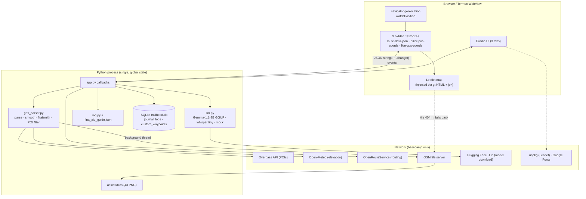
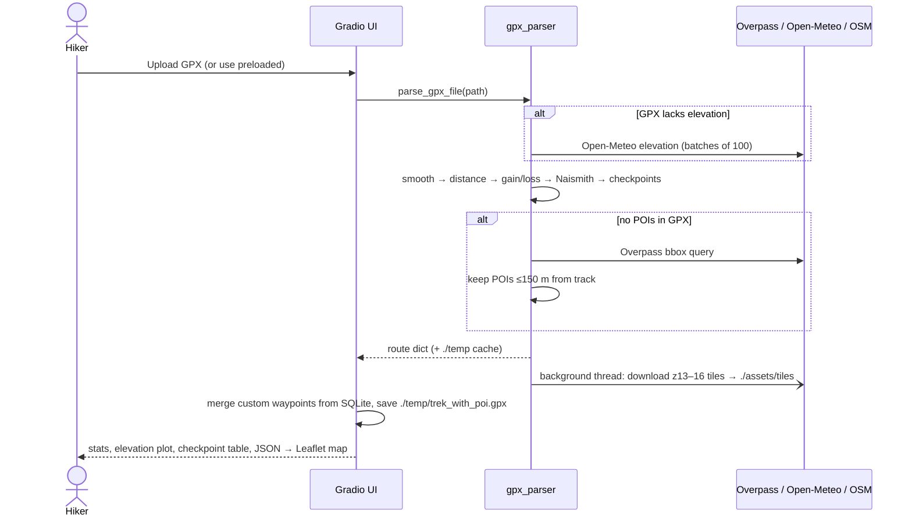
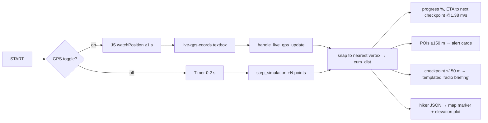

# Trailhead — Project Status Report, Technical Reference & Roadmap

| | |
|---|---|
| **Repository** | `xandie985/TrailHead` (branch `main`, last commit 2026-06-16, 53 commits, 1 contributor) |
| **Report date** | 2026-10-08 (updated 2026-10-09: added D13–D14; re-scoped §9–§12 to the two-track plan) |
| **Purpose** | Baseline for adding features/enhancements and producing an Android APK |
| **Roadmap** | The project now has two tracks: this repo as the **Hugging Face showcase**, and a separate open-source **Android + web app**. Future work, the market-gap analysis and the data/licensing constraints are in [`ROADMAP.md`](ROADMAP.md). |
| **How this was produced** | Full read of all Python/JS/CSS source, plus a scratch-venv run of the app (Gradio 6.18.0 on Python 3.13). Items marked **[verified]** were executed; items marked **[read]** come from reading code only. |

---

## 1. Executive summary

Trailhead is a single-process **Python/Gradio web app** that acts as a "trail computer": it ingests a GPX route, computes distance/elevation/Naismith time, shows the route and POIs on a Leaflet map, tracks a hiker (simulated playback or browser GPS), answers wilderness/first-aid questions with a local LLM + keyword RAG, and keeps a geotagged voice journal that can be turned into a trek story.

**Overall state: a working hackathon-grade prototype (v0.1).** The core planner, HUD, simulation, SQLite persistence and first-aid search work end to end **[verified]** with the bundled Trento route. The AI features (LLM, ASR) fall back to canned "mock" output when the native models are missing, and several headline claims in the README ("offline-first", "Gemma-4", LLM-narrated checkpoints, audio alerts) are **not yet true** in the code.

| Area | Status | Notes |
|---|---|---|
| GPX ingest, stats, smoothing, Naismith | ✅ Working **[verified]** | 3.49 km / 380 m gain / 252 pts / 5 checkpoints / 4 POIs on bundled route |
| POI fetch (Overpass) + 150 m buffer | ✅ Working **[read]**, needs network | Bundled route uses a pre-baked cache |
| Map + route + POI markers (Leaflet) | ✅ Working **[verified]** page serves | Leaflet JS/CSS loaded from unpkg CDN → online only |
| **Offline map tiles** | ❌ **Broken** **[verified]** | 43 tiles bundled, but the URL the map requests returns **404** (see D2) |
| Simulation player / HUD / proximity alerts | ✅ Working **[read]** | Visual only; no audio despite README |
| Live GPS (browser Geolocation) | 🟡 Implemented **[read]**, not testable headless | Needs HTTPS/localhost; foreground only |
| Custom waypoint tagging (SQLite) | 🟡 Works, but **"Clear" crashes** **[verified]** (D1) | |
| First-aid RAG (keyword) | ✅ Works **[verified]** | Only 5 manual sections |
| Chat / Guide LLM (llama.cpp, gemma-1.1-2b) | 🟡 **[read]** | Not run here (no model/llama-cpp). Silently degrades to canned mock replies |
| Voice journal ASR (whisper.cpp tiny) | 🟡 **[read]** | Same: falls back to canned transcript text |
| Story generator | 🟡 **[read]** | Real LLM or regex-driven mock template |
| Tests / CI | ❌ None | 3 ad-hoc scripts in `scratch/`, one with a hard-coded Windows path |
| Android APK | ❌ None | Only a Termux how-to in the README |
| Packaging/deploy | 🟡 | HF Space front-matter and Dockerfile were removed from the repo |

**Top-line recommendations**

1. Fix the concrete defects in §8 (≈1–2 days). One makes the first-aid tool unsafe when the LLM is absent. D13 breaks the OSM tile usage policy, and D14 leaks one visitor's data to others on a public Space.
2. Make "offline" real for the showcase: self-host Leaflet, fonts and tiles from a source that permits offline use, and fix tile serving (≈1–2 days).
3. For Android: a Gradio server cannot simply be "wrapped" and stay offline. **Decision (2026-10-09):** keep the Gradio app as the HF showcase and build the Android + web app as a separate client-side, offline-first product. See §10 and [`ROADMAP.md`](ROADMAP.md).

---

## 2. Repository inventory

```
TrailHead/
├── app.py                    1,816 lines  Gradio UI, all callbacks, embedded 380-line Leaflet JS bridge
├── src/
│   ├── gpx_parser.py           622        GPX parse, elevation fetch/smooth, POIs (Overpass), checkpoints, tile downloader
│   ├── llm.py                  566        llama.cpp loader, whisper.cpp/transformers ASR, mock generator, streaming
│   ├── rag.py                   81        keyword-overlap retriever over first_aid_guide.json
│   ├── database.py             120        SQLite: journal_logs, custom_waypoints
│   └── data/
│       ├── first_aid_guide.json          5 sections of wilderness first-aid text
│       └── trento_route_cache.json       pre-parsed bundled route (points, checkpoints, 4 POIs)
├── Routes/track_5-14724236830.gpx        bundled Trento loop (3.49 km) + Routes/cache/*.json
├── assets/custom.css         176          "tactical HUD" amber/dark theme (imports Google Fonts)
├── assets/tiles/{13,14,15}/…             43 OSM PNG tiles around the Trento route (1.4 MB)
├── media/                                README screenshots/GIFs (28 MB — dominates the repo)
├── scratch/test_*.py, test_overpass.py   manual scripts, not a test suite
├── requirements.txt
└── README.md                             (no LICENSE file, though README links one)
```

**Stack:** Python 3.11+ · Gradio 6.18 · gpxpy · folium (legacy path) · Plotly · pandas · requests · SQLite3 · llama-cpp-python 0.2.79 · pywhispercpp + miniaudio · Leaflet 1.9.4 (CDN) · Open-Meteo (elevation) · OSM Overpass (POIs) · OpenRouteService (optional routing).

---

## 3. Architecture



**Key architectural characteristics**

- **Server-rendered UI, client-side map.** Python never draws the live map; it pushes JSON into hidden textboxes whose `.change` events call JS handlers (`routeDataChangeHandler`, `updateHikerPosHandler`) defined in `MAP_INIT_JS` (`app.py:26-440`). This avoids iframe flicker but couples the app tightly to Gradio's DOM.
- **GPS is browser-side**: JS writes `{lat,lon,ele,acc}` into `#live-gps-coords` → Python callback `handle_live_gps_update` recomputes HUD/alerts and returns hiker JSON → map marker. Every GPS fix is a server round-trip.
- **Global, single-user state.** One SQLite file (`./trailhead.db`, relative path), one global `_llama_model` behind a lock, one `./temp/` dir. Per-session state is only `gr.State` (route, point index).
- **Graceful-degradation chain** (LLM): `llama_cpp` → on any failure/timeout → `generate_mock` (canned text). ASR: whisper.cpp → transformers Whisper → canned transcript.

---

## 4. Component reference

### 4.1 `src/gpx_parser.py` — deterministic engine
| Function | What it does |
|---|---|
| `parse_gpx_file` | Reads tracks → routes → waypoints (first non-empty). Fetches elevation from Open-Meteo **only if no point has elevation**; smooths (5-pt moving average); builds cumulative haversine distance; gain/loss with 2 m hysteresis; Naismith `km/5 + gain/600`; `estimated_days = max(1, hours/8)`. Caches result as `./temp/<name>.cache.json` **keyed by filename only**. Kicks off background tile download. |
| `extract_pois_from_gpx` | Reads POIs from `<wpt>` (type parsed from `"Type: …"` description or guessed from name) and `<extensions><poi …>` on track points. |
| `fetch_overpass_pois` / `filter_pois_near_track` | Overpass bbox query (water, spring, fountain, huts, camp, shelter, viewpoint, peak, phone), then O(P×N) haversine filter to 150 m. |
| `generate_checkpoints` | Start, every 1 km, End — or, if the GPX has waypoints, those snapped to the track. |
| `download_tiles_for_bbox` | Zoom 13–16 (13–15 if >120 tiles), 0.05 s delay, OSM User-Agent. |
| `save_enhanced_gpx` | Writes POIs back as `<wpt>` + track-point `<extensions>` → `./temp/trek_with_poi.gpx`. |

### 4.2 `app.py` — UI + orchestration
- **Tab 1 – Trek Planner & HUD:** route dropdown (1 preloaded) + GPX upload, GPS toggle, ▶/⏸/🔄 controls, speed slider, proximity alerts, custom-waypoint accordion, stats cards, Leaflet map, Plotly elevation profile, checkpoint table.
- **Tab 2 – Wilderness Guide:** `gr.ChatInterface(respond)` + static Emergency Card + manual quick-search.
- **Tab 3 – Voice Journal & Reports:** mic recorder → `handle_save_journal` → transcript + position → SQLite; story style radio → `handle_generate_story` → Markdown + download.
- **State / events:** `route_state` (full route dict incl. all points), `current_point_idx`, a 0.2 s `gr.Timer` for simulation (`step_simulation`), `live_gps_coords.change` → `handle_live_gps_update`.
- Unused-in-practice legacy: `generate_folium_map` / `get_map_iframe` / `fetch_ors_route` (ORS has no UI control; `handle_ors_fetch_click` is never wired).

### 4.3 `src/llm.py`
- `BACKEND` is **hard-forced to `"llama_cpp"`** (`llm.py:17`) regardless of availability; real fallback is inside `generate_llama_cpp`.
- Model: `bartowski/gemma-1.1-2b-it-GGUF` Q4_K_M, downloaded from HF on first use into `./model`; `n_ctx=2048`, `max_tokens=512`, temp 0.3, 4 threads (1 on HF Spaces). 120 s init/prefill budget; after one timeout the model is **permanently disabled** for the process.
- ASR: `pywhispercpp` "tiny" (+ `miniaudio` resample to 16 kHz mono) → transformers `whisper-tiny` → canned sentence.
- `generate_mock` is a ~330-line keyword/regex responder that also renders the story templates.

### 4.4 `src/rag.py`
Loads `first_aid_guide.json` on **every query**, scores sections = 3×(topic keyword hit) + 1×(query-word substring hit), returns **top-1** section as grounding text + citation. No stemming or stop-word list; the overlap test is raw substring matching (`word in combined_text`, words >2 chars), so e.g. "ice" also matches "service"/"device", and common words ("the", "how") add noise score.

### 4.5 `src/database.py` — schema
```sql
journal_logs      (id PK, timestamp DEFAULT CURRENT_TIMESTAMP, lat, lon, ele, cum_dist, transcript)
custom_waypoints  (id PK, timestamp DEFAULT CURRENT_TIMESTAMP, lat, lon, ele, type, name, description)
```
Opens/closes a connection per call; no indexes, no trek/session table, no route association, no migrations. Rows are global across all users and all routes.

### 4.6 Route JSON contract (what the JS map consumes)
```jsonc
{ "points":      [{"lat","lon","ele","cum_dist"(m)}],
  "checkpoints": [{"name","lat","lon","ele","cum_dist"(km)}],
  "pois":        [{"id","lat","lon","type","name","distance"(m),"track_index"}],
  "tiles_dir":   "<absolute server filesystem path>" }   // leaks server path to client
```
Hiker JSON: `{"lat","lon","ele","cum_dist"(km)}`. Live GPS JSON: `{"lat","lon","ele","acc","_ts"}`.
Note the unit mix: `points[].cum_dist` is **metres**, `checkpoints[].cum_dist` and hiker `cum_dist` are **km**.

---

## 5. Workflows

### 5.1 Basecamp (planning, online)


### 5.2 On trail (HUD loop)

Tag-waypoint: position JSON → `custom_waypoints` insert → POI appended to `route_state` → map JSON re-pushed.

### 5.3 Guide chat / first-aid
`respond(message, history)` → `rag.retrieve_first_aid` → if hit: system prompt "use ONLY the context + cite"; else generic hiking-advisor prompt → `llm.generate(stream=True)` → tokens yielded to chatbot. The quick-search accordion runs the same retrieval non-streaming.

### 5.4 Voice journal → story
Mic audio (filepath) → `llm.transcribe_audio` → `db.add_journal_entry(lat, lon, ele, cum_dist, text)` → table refresh. Story: all journal rows (oldest first) + route stats + checkpoints + POIs → one prompt → `llm.generate` → `./temp/post_trek_story.md` for download. Two styles: "Minimal Technical Gist" and "Social Media Post".

### 5.5 Dev workflow (observed)
Single developer; feature branches (`dev_skeleton_and_features`, `dev_final_features`, `dev_gps_features`, `final_documentations`) merged to `main` via PRs #1–#5 (all self-merged within minutes — no review, no CI, no issues). Commit history 2026-06-10 → 2026-06-16.

---

## 6. External dependencies & real offline matrix

| Capability | Needs network when… | Truly works offline today? |
|---|---|---|
| Map base layer | Always (see D2): tiles 404 → OSM | ❌ |
| Leaflet JS/CSS | Always (unpkg) | ❌ (map never initialises offline) |
| Fonts | Always (Google Fonts `@import`) | 🟡 falls back to system fonts |
| Route stats | Only if GPX lacks elevation | ✅ |
| POIs | Only for user-uploaded GPX w/o POIs | ✅ for bundled route |
| LLM | First run (model download from HF, ~1.5 GB) | ✅ after download, if llama-cpp-python installed |
| ASR | First run (whisper `tiny` download) | ✅ after download |
| GPS | Never (device GNSS) | ✅ (needs secure context) |

---

## 7. Gaps between README and code

| README claim | Reality |
|---|---|
| "Gemma-4 GGUF" (diagram) | `gemma-1.1-2b-it` Q4_K_M (`llm.py:21`) |
| "Proximity Checkpoint Narration" via AI | Plain f-string template; **no LLM call** (`app.py` `step_simulation`/`handle_live_gps_update`) |
| "Audio-visual indicators" for proximity | Visual only; no audio code |
| "Offline-first … download map tiles" | Tile URL 404s (D2); Leaflet from CDN |
| "Throttled at 5 seconds" (GPS) | JS throttle is 1 s; status text still says 5 s |
| Naismith-based ETA | Next-checkpoint ETA uses constant 1.38 m/s, ignores slope |
| Off-route/"deviation" guidance | Only exists as a canned mock string; no deviation computation |
| `LICENSE` link | File missing |
| HF Spaces deploy | README YAML front-matter and Dockerfile deleted in last commits |
| "mobile-friendly" | Desktop-styled Gradio layout; not tuned/tested for phones |

---

## 8. Verified & identified defects (prioritised)

| ID | Sev | Finding | Evidence / location |
|---|---|---|---|
| **D1** | High | **"Clear Tagged Waypoints" crashes** with `NameError: name 'json' is not defined` — `json` is only imported locally inside other functions; DB is cleared but UI/map are not refreshed. | `app.py:1322-1337` **[verified]** |
| **D2** | High | **Bundled offline tiles are never served.** Map requests `/file=<abs path>/z/x/y.png`; Gradio 6 returns 404 (`/file=`) / 403 (`/gradio_api/file=` – path not in `allowed_paths`). Map silently falls back to online OSM. Also `tiles_dir` exposes a server filesystem path, and `maxZoom: 16` is set while only z13–15 are bundled. | `app.py:99-106`, `demo.launch(...)` has no `allowed_paths` **[verified]** |
| **D3** | High (safety) | **Mock fallback gives wrong medical advice.** If llama-cpp/model is missing or times out (permanently, for the process), *any* query containing "injury/medical/sick/ams/…" returns the **ankle-sprain R.I.C.E.** protocol, labelled "CITED". Presented to the user as if it were the AI answer. | `llm.py` `generate_mock` branch 3; `BACKEND` forced at `llm.py:17` **[read]** |
| **D4** | Med | Nearest-**vertex** snapping on a **loop** route (start == end): near the trailhead progress can jump between 0% and 100%; vertex snapping also gives stair-step distance. Cost is O(N) per fix, per GPS tick. | `handle_live_gps_update`; preloaded route is a loop **[read]** |
| **D5** | Med | Custom-waypoint ID `custom_{len(custom_wps)}` collides/diverges from DB ids after deletes; custom-waypoint types incl. `hazard` have no icon/colour mapping. | `app.py:1301` **[read]** |
| **D6** | Med | Parse cache is keyed by **file name only**: two different uploads named `track.gpx` return the first one's data. Cache lives in `./temp` which is never cleaned. | `gpx_parser.py` `parse_gpx_file` **[read]** |
| D7 | Med | ~120 lines duplicated between `step_simulation` and `handle_live_gps_update`; route-JSON assembly copy-pasted 5×; `handle_ors_fetch_click` dead code. | `app.py` **[read]** |
| D8 | Med | Global LLM lock + 120 s blocking prefill: one chat/story request blocks all users; no per-request cancel; model disabled forever after one slow call. | `llm.py` **[read]** |
| D9 | Low | Personal email address embedded in HTTP `User-Agent` in source (2 places). | `gpx_parser.py:108,570` |
| D10 | Low | `requirements.txt`: `gradio[oauth,mcp]` extras unused; `llama-cpp-python==0.2.79`, `pywhispercpp`, `miniaudio` are hard requirements though documented as optional (installing on a machine without a compiler fails the whole install); `folium` only used by legacy path. | `requirements.txt` |
| D11 | Low | No tests/CI; test scripts need network and one has a hard-coded `C:\Users\…` path. Repo is 29 MB, mostly README GIFs in git history. | `test_overpass.py:6` |
| D12 | Low | Unit inconsistency (m vs km) across `cum_dist` fields; proximity radius, walking speed (1.38 m/s), checkpoint interval are magic numbers. | throughout |
| **D13** | High (compliance) | **Tile prefetch breaks the OSM tile usage policy.** `download_tiles_for_bbox` bulk-downloads z13–16 tiles from `tile.openstreetmap.org` in a background thread for offline use. OSMF's policy does not permit offline use or prefetching on that server, and offending clients can be blocked without notice. The 43 bundled tiles came from the same source. Fix: serve tiles built from an ODbL extract (e.g. a Protomaps PMTiles extract) or from a provider that allows offline use. Also drop the deprecated `{s}.` subdomains in the live layer. | `src/gpx_parser.py:526-584`, `app.py:73,83` **[read]** |
| **D14** | High (privacy, public Space) | **All visitors share one database.** `get_journal_entries()` / `get_custom_waypoints()` return every row, and the clear buttons delete every row. On a public HF Space, any visitor can see other visitors' journal transcripts and the GPS coordinates stored with them, and can wipe them. Fix: key rows by a per-session/browser ID, or keep showcase data in session state only. | `src/database.py`; `app.py:858,918,1283,1323,1366-1377` **[read]** |

---

## 9. Enhancement backlog

> **Re-scoped 2026-10-09.** The work is now split into two tracks, detailed in [`ROADMAP.md`](ROADMAP.md):
> - **Track S, Showcase:** this repo and Gradio app on Hugging Face Spaces. Kept stable and honest; used to prototype algorithms.
> - **Track A, App:** a separate open-source Android + web app, offline-first. It addresses the market gaps: verified trail data, reliable offline downloads, battery-aware tracking, multi-day stage planning, clean trek-mode UI, and no paywalls.
>
> This section lists only showcase work. Product features moved to `ROADMAP.md` §3 and §6.

**S0 — stabilise and comply (≈3–4 days).** Exit criteria are in `ROADMAP.md` §6.1.
1. Fix D1: add `import json` at module top, and refresh the table and map JSON after clearing.
2. **D13 + D2: tiles.**
   - Stop prefetching from `tile.openstreetmap.org`.
   - Bundle a small demo-area tile set built from an ODbL extract (Protomaps PMTiles or rasterised).
   - Serve it via a static mount, or via `allowed_paths` + `/gradio_api/file=` with relative URLs.
   - Set min/max zoom from what is bundled, and show "© OpenStreetMap contributors".
3. Vendor Leaflet and fonts into `assets/`.
4. **D14:** per-session storage, so visitors cannot see or clear each other's journal, waypoints or positions.
5. **D3:** make LLM failure explicit.
   - Show a visible "AI model unavailable — showing manual excerpt" banner.
   - The fallback returns the retrieved manual text verbatim.
   - Canned text is never labelled "CITED".
6. **D4–D6.**
7. Correct the README: model name, claims, and demo vs app scope. Also:
   - Add LICENSE and restore the HF front-matter.
   - Remove the email from the User-Agent (D9).
   - Credit Open-Meteo (CC BY 4.0).
8. Split `app.py` into `ui/`, `services/` and `static/map.js`. Extract one `compute_hud(lat, lon, route)` for both simulation and GPS (D7).
9. **Engineering:**
   - A pytest suite for `gpx_parser`, `rag`, `database` and the snapping/ETA maths, using **golden fixtures**: GPX in, expected JSON out. These fixtures become the shared spec for the app.
   - GitHub Actions: lint and tests, no network.
   - Pin dependencies; split `requirements.txt` into `core` / `ai`.
   - Move README media out of git.

**S1 — demo the product ideas (≈1–2 weeks).**
- Readiness-check panel.
- Off-route detection with browser speech alerts.
- Segment-projection snapping (fixes D4).
- Drift-filter demo: raw vs filtered.
- **Multi-day stage planner prototype**, with huts, water and bail-outs per stage.
- POI provenance badges.
- Slope-aware ETA.
- SOS coordinates screen.

**S2 — optional polish.**
- Local condition-report mock.
- Precomputed LLM checkpoint briefings.
- Extractive-first first aid with a smaller model.
- BM25 / top-k retrieval with citations.

**Where the earlier P1/P2 items went**
| Earlier item | Now |
|---|---|
| Off-route detection + alert | S1 (detection, browser speech) · A2 (native, TTS/haptics) |
| Segment snapping with direction | S1 · A0 (ported via spec) |
| Track recording + GPX export | A2 (needs background tracking) |
| Slope-aware ETA | S1 · A0 |
| Trek/session DB model | S0 (per-session, D14) · A0 (full schema) |
| LLM checkpoint briefings | S2 · A6 |
| Weather + sunrise/sunset | A3 (S2 optional) |
| Water/shelter planning, multi-day staging | S1 prototype · A3 |
| Better RAG / vetted corpus | S2 · A6 (vetted corpus is a release blocker for AI) |
| Emergency/SOS screen | S1 · A2 |
| Pre-trip checklist | A3 |
| Battery saver mode | A2 (adaptive polling, expedition mode) |
| Units / i18n | A5 |
| Offline DEM instead of Open-Meteo | A1 (region packs) |
| 3-D profile/terrain, peer location share, photo geotagging, share cards | Later (`ROADMAP.md` §3.7) |

---

## 10. Android APK strategy

### 10.1 Why this is not a "just wrap it" job
Trailhead's backend is Python + native C++ wheels (`llama-cpp-python`, `pywhispercpp`, numpy/pandas/pydantic-core for Gradio). Android has no system Python, and Gradio assumes a long-running local HTTP/WebSocket server. Anything that stays offline must either **embed Python on-device** or **move logic to the client**.

### 10.2 Options

| # | Approach | Offline? | Reuses current code | Effort | Main risks |
|---|---|---|---|---|---|
| A | **Termux + browser** (current README) | ✅ | 100% | done | Not an APK; manual install; compiling llama.cpp on phone is painful |
| B | **WebView/TWA/Capacitor shell → hosted Gradio** (HF Space or LAN box) | ❌ needs connectivity | 100% | ~1–2 days | Contradicts "off the grid" promise; fine only as a demo/skeleton APK |
| C | **Embed CPython in the APK** (e.g. Chaquopy / BeeWare / python-for-android) running Gradio on `127.0.0.1` + WebView | ✅ | ~90% | 2–4 weeks | Wheel availability for Gradio's native deps on arm64 + Python 3.11–3.13 **(must be verified in a spike)**; APK size; cold-start of Gradio (seconds–10s+); llama.cpp/whisper.cpp must be NDK-cross-compiled; Gradio is heavy for a phone |
| D | **Client-side re-architecture (recommended end-state)**: Capacitor (or Kotlin + WebView) app; Leaflet + local tiles (MBTiles/PMTiles); SQLite via plugin; GPX/elevation/Naismith/RAG ported to TypeScript; **native plugins** for GPS (background foreground-service), on-device LLM (llama.cpp JNI / MediaPipe LLM Inference / MLC) and ASR (whisper.cpp JNI or offline `SpeechRecognizer`) | ✅ | Algorithms/data/prompt design (not code); the JS map code is largely reusable | 4–8 weeks | LLM model size (≈1.5 GB → on-demand download, not in APK); device RAM; background-location permissions & Play policy |

### 10.3 Decision (2026-10-09), replacing the earlier staged plan
- **Android is a separate product (Track A),** built client-side from day one. This is option D, refined in `ROADMAP.md` §5:
  - TypeScript + Capacitor, shipping to Android and web (PWA);
  - MapLibre GL with PMTiles region packs;
  - SQLite;
  - native plugins for background tracking, downloads, offline routing, TTS and optional AI.
- **Option B is dropped.** The demo-APK role it served (an online shell) is filled by the HF Space showcase.
- **Option C is dropped.** Track A won't embed the Gradio app, so its feasibility spike is unnecessary.
- **Option A (Termux)** stays documented for the showcase as a hobbyist path, not a product.
- **Release plumbing,** carried into A0/A6:
  - a release keystore;
  - `.aab`/`.apk` builds in GitHub Actions;
  - `foss` and `play` build flavours;
  - pack and model downloads with checksum and resume;
  - crash logging that works offline (no proprietary SDK in `foss`).

### 10.4 Build-environment readiness (this cloud session) **[verified]**
| Tool | Present |
|---|---|
| Java (JDK) / Gradle / Node 22 / npm / Docker | ✅ |
| Android SDK, `sdkmanager`, `adb`, NDK | ❌ not installed (would need command-line tools download; network allow-list not yet checked) |
| Physical device / emulator | ❌ (cannot test GPS/mic/LLM performance here; needs a real phone) |
| 4 vCPU / 15 GB RAM | adequate for Gradle builds |

### 10.5 Android-specific requirements to design for
Foreground-service location tracking with a persistent notification (Android 10+ background location rules), `RECORD_AUDIO`, storage via scoped storage/app-private dir, large-model download over Wi-Fi with resume, wake-lock/battery-optimisation guidance, WebView geolocation permission prompt handling, and dark/sunlight-readable UI at phone widths (current Gradio layout is desktop-first).

---

## 11. Milestone plan

Moved to [`ROADMAP.md` §6](ROADMAP.md#6-milestones). Summary:

| Track | Milestones |
|---|---|
| **S — Showcase** (this repo) | **S0** stabilise and comply (D1–D6, D13, D14, offline assets, README truth, tests + CI) → **S1** demo the product ideas (readiness check, off-route, drift filter, stage planner) → **S2** optional polish |
| **A — App** (new repo) | **A0** foundations and spikes → **A1** offline-first core (region packs, download manager, readiness check) → **A2** tracking, navigation and safety → **A3** planning (offline routing, multi-day stages) → **A4** trail truth (provenance, condition reports; needs a backend) → **A5** trek-mode UX → **A6** AI packs and release |

## 12. Open questions for the maintainer

Answered on 2026-10-09:
- **APK intent:** a truly offline app, built as a separate product.
- **Hosting:** keep the Hugging Face Space as the showcase.
- **Scope priority:** the market-gap analysis now drives priorities (`ROADMAP.md` §3).

Still open, with recommendations, in [`ROADMAP.md` §9](ROADMAP.md#9-decisions-needed):
- repo layout;
- app licence;
- beachhead region;
- Android baseline and reference devices;
- routing engine;
- reports backend;
- first-aid content source;
- distribution channel.

---
*Appendix — commands used to verify:* installed Gradio 6.18.0 + deps in a scratch venv; imported `app`; ran `handle_route_update` on the bundled route; ran `rag.retrieve_first_aid` on sample queries; launched the server and requested the tile URL (404/403); invoked `handle_clear_waypoints` (NameError). LLM/ASR inference, live browser GPS and Overpass/Open-Meteo calls were **not** exercised.
