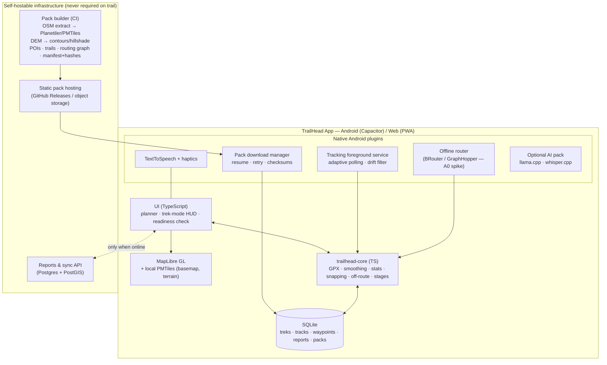

# TrailHead — Two-Track Product Roadmap

| | |
|---|---|
| **Date** | 2026-10-09 |
| **Scope** | Future work for (S) the Hugging Face **showcase** and (A) a separate open-source **Android + web app** |
| **Supersedes** | §9–§12 of [`PROJECT_REPORT.md`](PROJECT_REPORT.md) (backlog, APK strategy, milestones, open questions). Its technical reference and defect list (§1–§8) still apply. |
| **Inputs** | The code audit in `PROJECT_REPORT.md`. Market research on drawbacks of current trekking apps (AllTrails, Gaia GPS, Komoot, …), supplied by the project owner; its sources are listed in §10 and were not re-verified here. Data-provider usage policies, checked on 2026-10-09 (§4). |

---

## 1. Decision: two tracks

| | **Track S — Showcase** | **Track A — TrailHead App** |
|---|---|---|
| Purpose | Public demo / portfolio on Hugging Face Spaces, plus the lab where algorithms are prototyped | Practical, open-source alternative to paid trekking apps |
| Platforms | Browser (HF Space) and desktop | Android (APK/AAB) and web (PWA) from one codebase |
| Stack | Python · Gradio · the current code | TypeScript · Capacitor · MapLibre GL · PMTiles · SQLite · native Android plugins (§5) |
| Offline promise | "Offline-capable demo": an honest, limited claim | Offline-first by design, tested in airplane mode |
| Users and state | Anonymous visitors, many per Space, ephemeral storage | One owner per device; data stays on the device; sync is optional |
| Repository | This repo (`xandie985/TrailHead`) | A new repo is recommended, e.g. `trailhead-app` (decision X1 in §9) |
| Change policy | Fix defects and add small demo features; no rewrites | Where most of the effort goes |

**What the tracks share.** Showcase code is Python and app code is TypeScript, so they share specifications, not code:

- **`spec/algorithms.md` plus golden fixtures.** The spec covers:
  - elevation smoothing, distance and gain/loss;
  - Naismith/Tobler timing;
  - segment snapping and off-route detection;
  - drift filtering and multi-day stage splitting.

  Each fixture is a GPX input with its expected JSON output, and both implementations must pass every fixture. New algorithms are prototyped in Python in the showcase first, then ported.
- **POI taxonomy:** OSM tag → category → icon/colour → proximity radius.
- **First-aid corpus:** vetted, cited and versioned JSON, plus the prompt templates.
- **Trek bundle format:** GPX + POIs + stages + manifest, so a route planned in one track opens in the other.

---

## 2. Positioning

The research points to four principles: **accuracy over quantity, reliability over features, clarity over clutter, transparency over upsells.**

**Open-source competitors exist.** Open-source offline map apps already exist (OsmAnd; Organic Maps / CoMaps) and handle general offline maps and routing well. TrailHead App should not compete as a general map app. It should be a **hiking companion** that solves the problems hikers complain about and those apps don't focus on:

1. **Pre-hike readiness.** One screen proves that everything needed is on the phone and verified before you lose signal.
2. **Trail truth.** Every trail and POI shows its provenance (official, OSM or user). Condition reports are timestamped and expire.
3. **Multi-day stage planning.** Stages end at huts or campsites, and each stage shows its water sources and bail-out points.
4. **Trek-mode UI.** Minimal screens, glove-friendly controls, audio cues and battery-aware tracking.
5. **Offline safety layer.** An SOS screen with coordinates, a first-aid manual and an optional on-device assistant.
6. **Free and open.** No essential feature sits behind a paywall.

Where proven open components exist, reuse them rather than rebuilding. For example, BRouter (MIT licence) already does offline routing on Android.

**Beachhead segment (recommendation): multi-day hut-to-hut trekkers in the Alps, starting with Trentino/Dolomites.** Reasons:
- The demo route is already there.
- The rifugi network is dense and well mapped in OSM.
- Stage planning is the core need for this segment.

Grow region by region through data packs (§5).

---

## 3. Gap → feature map

The **Today** column shows the current state of this repo. In the **Track/milestone** column, S = showcase and A = app; milestones are defined in §6.

### 3.1 Inaccurate or outdated trail data
| Complaint | TrailHead response | Track/milestone | Today |
|---|---|---|---|
| Trails shown open are closed, rerouted or washed out | **Condition reports**, each with:<ul><li>a type: closure, washout, snow/ice, fallen trees or bridge out;</li><li>a timestamp and an optional photo;</li><li>confirm/deny votes and a type-specific expiry.</li></ul>A closure overlay appears on the map, and the app warns when a planned route crosses an active report. | A4 · S2 (local-only mock) | none |
| Official trails mixed with one-off user tracks | **Provenance on every trail, route and POI:**<ul><li>`official`: land-manager open data;</li><li>`osm`: `highway=path/footway` ways and hiking route relations, with `sac_scale` and `trail_visibility`;</li><li>`user`: uploaded GPX.</li></ul>Each source has a distinct map style and its own filter. "Verified" means official data, or user data confirmed by recent reports. | A3/A4 · S1 (POI badges) | POIs carry no source |
| Distance/elevation off by 20%+ | <ul><li>DEM elevation (e.g. Copernicus GLO-30) replaces GPS altitude.</li><li>Drift is filtered before distance is summed.</li><li>Values are shown with uncertainty, e.g. "3.5 km ± 0.1".</li><li>Accuracy is checked against reference fixtures in CI.</li></ul> | A1/A2 · S1 | Partial: 5-point smoothing and 2 m hysteresis; Open-Meteo only when the GPX has no elevation |

### 3.2 Offline map failures and paywalls
| Complaint | TrailHead response | Track/milestone | Today |
|---|---|---|---|
| Downloads fail at the trailhead, leaving blank maps | A **download manager** with:<ul><li>chunked, resumable downloads with retry/backoff;</li><li>a per-file BLAKE3/SHA-256 check against the pack manifest;</li><li>a size estimate and progress bar;</li><li>a "Wi-Fi only" option.</li></ul> | A1 | Background tile thread with no progress or verification. It also breaks OSM tile policy (D13). |
| No proof that you are ready to go offline | A **readiness check** that gates "Start trek". It shows red/green per item: map pack, terrain/DEM, route, POIs, routing graph, first-aid pack, optional AI models, and battery level. | A1 · S1 (demo panel) | none |
| Offline locked behind subscriptions | Every offline feature is free (§7). | policy | n/a |
| Manual area selection | **Route-corridor caching:** select the pack tiles covering the route plus a buffer (e.g. 2 km) at full zoom, and the surroundings at lower zoom. | A1 | Bbox at z13–16, max 120 tiles |

### 3.3 GPS drift and battery drain
| Complaint | TrailHead response | Track/milestone | Today |
|---|---|---|---|
| Dot jumps off-trail; zig-zag tracks | <ul><li>Drop fixes with poor accuracy (e.g. > 30 m).</li><li>Reject speed/teleport outliers.</li><li>Apply a Kalman filter.</li><li>Display the position snapped to the route while on-route, but keep the raw track separately.</li></ul> | A2 · S1 (raw vs filtered demo on a noisy fixture) | Raw fix snapped to nearest vertex (D4) |
| Battery drains before the hike ends | **Adaptive polling:**<ul><li>pause GPS when stationary (significant-motion sensor);</li><li>use long intervals on straight on-route segments;</li><li>use short intervals near junctions, checkpoints and when off-route.</li></ul>**Expedition mode:** a fix every 30–60 s, screen off, no map redraw. A remaining-battery estimate is shown. | A2 | Browser `watchPosition` at 1 s, foreground only |
| Multi-day background tracking | An Android **foreground service** with a persistent notification. Track writes are crash-safe (append-only SQLite in WAL mode), and tracking resumes after a reboot. | A2 | not possible in Gradio |
| No cleanup of recorded tracks | **Post-trek processing:** smoothing, Douglas–Peucker simplification, recomputed stats and GPX export. | A2 · S1 | none |

### 3.4 Route planning and navigation
| Complaint | TrailHead response | Track/milestone | Today |
|---|---|---|---|
| No point-to-point navigation or rerouting | <ul><li>**Offline routing** on the trail network, using BRouter, GraphHopper or Valhalla (the A0 spike picks one).</li><li>**Off-route detection:** distance to the nearest segment above 40–60 m for N seconds.</li><li>**Return-to-trail guidance:** bearing and distance.</li><li>A choice to reroute to the destination or to the nearest point on the route.</li></ul> | A2 (off-route) · A3 (reroute) · S1 (off-route only) | None. ORS code exists but is not wired up. |
| Route planners confuse new users | **A planner with three entry points:** import GPX, tap-to-route snapped to trails, or pick a known hiking relation. It has undo and live stats. | A3 | GPX upload only |
| Multi-day routes arrive as a single entry | **Stage planner:**<ul><li>a daily target in hours (Naismith/Tobler × personal pace factor), km or maximum ascent;</li><li>stage ends snapped to the nearest hut, campsite or shelter;</li><li>distance, ascent, descent and time per stage;</li><li>water sources and bail-out points (road, bus stop, hut with road access) per stage;</li><li>a "last water for X km" warning;</li><li>editable stage boundaries.</li></ul> | A3 · S1 (Python prototype) | `estimated_days = hours/8` only |

### 3.5 Cluttered UI and mixed-quality content
| Complaint | TrailHead response | Track/milestone | Today |
|---|---|---|---|
| Too many trail variants on screen | **Follow mode** dims or hides trails you are not on and shows only the active route and relevant POIs. `sac_scale` works as a difficulty filter. | A5 | n/a |
| Information overload while moving | **Trek-mode HUD:**<ul><li>next instruction;</li><li>distance to the next checkpoint and water;</li><li>ETA;</li><li>off-route state.</li></ul>The full map opens on tap. | A5 | Desktop-style Gradio layout |
| Hands-free use (gloves, poor visibility) | **Audio cues:** text-to-speech for junctions, off-route warnings, an approaching hut/water/checkpoint, and sunset. Haptic patterns accompany them. Uses Android TextToSpeech with offline voices; the showcase uses browser `speechSynthesis`. | A2/A5 · S1 | None (the README claims audio) |
| Stale condition reports | Reports show their age and are hidden after a type-specific expiry (e.g. snow 7 days; closures until confirmed reopened). "Still there?" prompts collect confirmations. | A4 | n/a |

### 3.6 Subscription fatigue and hidden costs
See §7. The app is open source, has no paywall on essentials and no account requirement, and README publishes a pricing promise.

### 3.7 Niche and geospatial features
| Idea | Plan | Track/milestone |
|---|---|---|
| OSM/Overpass for fresh trail data | Region packs are built from OSM extracts (e.g. Geofabrik) on a weekly schedule. Live Overpass is used only for small, cached, on-demand queries, because public-instance limits count all app users together (§4). To contribute fixes back, the app links to OSM Notes and the OSM editor. | A1 pipeline · A4 |
| GPX import/export with smart merging | Import, export and trek bundles come first. Merging is a later step: map-match many user tracks to the OSM trail graph, build a consensus line, and submit it as a "candidate route" for verification. | A0 (I/O) · later (merging) |
| Offline routing engines | See §3.4. Prefer an engine already proven offline on Android (BRouter). | A0 spike → A3 |
| AR trail markers | Research only, after the core is solid. It conflicts with the battery goal, and compass/camera accuracy is a known problem. | later |
| Premium layers (satellite, 3D terrain) | 3D terrain from the DEM is feasible (MapLibre terrain). Satellite imagery licensed for offline use is scarce, so check licensing before promising it. | later |

---

## 4. Data, licensing and policy constraints

Read this before building anything. Checked 2026-10-09; providers may change their terms.

| Source | Constraint | Impact |
|---|---|---|
| `tile.openstreetmap.org` (raster tiles) | The OSMF tile policy does not permit offline use or prefetching ("save area for later", "download for offline"). Offending clients may be blocked without notice. | **The current code violates this:** `download_tiles_for_bbox` (`src/gpx_parser.py:526-584`) prefetches tiles from it → new defect **D13**. Both tracks must serve their own tiles. |
| OSM data (ODbL) | Requires visible "© OpenStreetMap contributors" attribution. Databases derived from OSM are share-alike. | Region packs and any merged or "verified" trail database derived from OSM stay ODbL and must be published. |
| Protomaps basemap builds / Planetiler | An ODbL Produced Work in a single PMTiles file. `pmtiles extract --bbox --maxzoom` cuts out a region. Hotlinking is discouraged, so copy the file to your own storage. Builds ship BLAKE3 hashes. | The base for app region packs and for the showcase's bundled tiles. |
| Overpass API (public instance) | Fair use is under 10k queries and 1 GB per day. For recurring use the guidance is about 100 queries and 10 MB per day, counted across all of an app's users. Commercial use should self-host. | Showcase: acceptable with caching and an identifying User-Agent (but not a personal email, D9). App: use POI extracts built into the packs, not live Overpass. |
| Open-Meteo | The free tier is for non-commercial use: under 10k calls/day, with hourly and per-minute caps. Data is CC BY 4.0, so attribution is required. | Showcase: acceptable with attribution. App: elevation comes from the DEM in packs; the basecamp forecast uses Open-Meteo with attribution. Revisit if any paid tier is ever introduced. |
| DEM (Copernicus GLO-30 / SRTM) | Free, with attribution. Confirm the exact licence text before redistributing. | Used for offline elevation, contours and hillshade in packs. |
| Routing engines | BRouter is MIT and runs offline on Android (Locus and OsmAnd use it). GraphHopper is Apache-2.0. Valhalla is MIT. | All three are compatible with a permissive app licence. |
| Google Play services (FusedLocationProvider, Firebase) | Proprietary, so F-Droid rejects it. | Two build flavours: `foss` (platform `LocationManager`) and `play`. No proprietary crash or analytics SDK in `foss`. |
| Android background location | Needs a foreground service with a persistent notification. Play Store requires a background-location declaration. | Shapes the A2 design and the store listing. |
| User reports and photos | Need moderation and abuse handling. Strip EXIF and blur home locations for privacy. Contributors must agree to a licence. | A backend, terms of service and a moderation path are required before A4 goes public. |
| First-aid content | Medical liability. | Needs a vetted, cited, versioned corpus and a disclaimer. Answers are extractive by default; generated text is opt-in. |

---

## 5. Track A architecture (recommended)

**One TypeScript codebase for web and Android.** Parts critical to battery and accuracy are native Android plugins.



**Why this stack**
- The project has one developer who already writes web/Leaflet JavaScript. One codebase yields both the Android app and the web version.
- Tracking, downloads, routing, TTS and AI would be native plugins in any stack.
- MapLibre GL renders vector tiles, which keeps packs small and stays sharp at every zoom. Its styling can hide trails you are not following (follow mode). PMTiles stores a region in one file, which is easy to verify and read offline.

**Alternatives considered**
- *Kotlin-native Android plus a separate web app:* the best performance and battery life, but two codebases.
- *Flutter:* one codebase, but Dart, and its web-mapping tooling is less mature.

**Main risk to test in A0:** MapLibre GL JS performance inside the Android WebView on a low-end phone. If it is too slow, fall back to MapLibre Native Android behind the same plugin interface.

**Region pack** (the unit of offline data)
```
trentino-2026-10-05/
  manifest.json     {id, version, bbox, built_at, osm_timestamp,
                     files:[{name, size, blake3}], licences, attribution}
  basemap.pmtiles   vector tiles (z0–15)
  terrain.pmtiles   contours + hillshade
  elevation.*       DEM for elevation lookup (format chosen in A1)
  pois.sqlite       huts, water, shelters, campsites, viewpoints, phones, bus stops
  trails.sqlite     trail network + provenance + hiking route relations
  routing/          routing-engine data for the chosen engine
```
Sizes per region are not estimated yet; measure them in the A0 spike.

---

## 6. Milestones

Durations are rough: focused weeks for one developer. Re-estimate after S0 and A0.

### 6.1 Track S — Showcase (this repo)

| Milestone | Scope | Exit criteria |
|---|---|---|
| **S0 Stabilise & comply** (~3–4 days) | <ul><li>Defects D1–D6 (`PROJECT_REPORT.md` §8).</li><li>**D13:** stop prefetching from the OSM tile server. Bundle a small tile set for the demo area built from a Protomaps extract (MapLibre + PMTiles, or rasterised), serve it correctly (fixes D2), and show attribution.</li><li>**D14:** per-session storage, so visitors cannot see or clear each other's journal, waypoints or GPS positions.</li><li>Vendor Leaflet and fonts.</li><li>README: remove false claims, add LICENSE and the HF front-matter, and state "demo vs app".</li><li>pytest suite with golden fixtures, plus a CI workflow.</li></ul> | <ul><li>The Space builds from this repo.</li><li>After page load, the map renders with the network blocked.</li><li>Two browser sessions see only their own data.</li><li>CI is green.</li></ul> |
| **S1 Demo the product ideas** (~1–2 weeks) | <ul><li>Readiness-check panel.</li><li>Off-route detection with browser speech alerts.</li><li>Segment snapping (fixes D4).</li><li>Drift-filter demo: raw vs filtered on a noisy fixture.</li><li>**Multi-day stage planner prototype:** hours/day → stages snapped to huts/campsites, with water and bail-outs per stage.</li><li>Provenance badges on POIs.</li><li>Slope-aware ETA.</li><li>SOS screen with coordinates.</li></ul>All algorithms are written to `spec/algorithms.md`. | <ul><li>Every feature has a fixture-based test.</li><li>The algorithm spec is ready for porting in A0.</li></ul> |
| **S2 Optional polish** | <ul><li>Local-only condition-report mock.</li><li>Precomputed LLM checkpoint briefings.</li><li>Extractive-first first aid, using a smaller or faster model on CPU Spaces.</li><li>Better retrieval (BM25, top-k with citations).</li></ul> | — |

After S1 the showcase is mostly maintenance, plus first prototypes of new algorithms.

On Hugging Face, Space storage is ephemeral unless persistent storage is enabled, and a CPU Space runs the 2B model slowly. So the demo must not promise persistence, and LLM features stay optional.

### 6.2 Track A — App (new repo)

| Milestone | Scope | Exit criteria |
|---|---|---|
| **A0 Foundations** (~2–3 wks) | <ul><li>Repo, Capacitor + Vite + TypeScript skeleton.</li><li>CI: lint, unit tests and a debug APK build.</li><li>MapLibre with one hand-built PMTiles pack.</li><li>GPX import/export.</li><li>SQLite schema: treks, tracks, waypoints, packs.</li><li>`trailhead-core` ported from the S1 spec and passing the golden fixtures.</li><li>**Spikes:** WebView map performance on a low-end phone; routing engine choice; pack sizes.</li><li>Licence decision.</li></ul> | <ul><li>The debug APK installs.</li><li>In airplane mode, the app opens a pack, imports a GPX, and shows a route whose stats match the fixtures.</li></ul> |
| **A1 Offline-first core** (~3–4 wks) | <ul><li>Pack builder pipeline in CI, with manifest and hashes.</li><li>Download manager: resume, retry, Wi-Fi only, integrity check.</li><li>Route-corridor prefetch.</li><li>DEM elevation.</li><li>**Readiness check.**</li><li>Attribution/licence screen.</li></ul> | <ul><li>A download survives a network cut mid-way (simulated).</li><li>A corrupted file is detected and re-fetched.</li><li>The readiness check turns green only when every item is verified.</li></ul> |
| **A2 Tracking, navigation & safety** (~3–4 wks) | <ul><li>Foreground tracking service with adaptive polling and drift filtering.</li><li>Crash-safe recording.</li><li>Off-route detection and return-to-trail guidance.</li><li>TTS and haptic cues.</li><li>Expedition battery mode.</li><li>Post-trek smoothing and GPX export.</li><li>SOS screen and the offline first-aid manual (non-AI).</li></ul> | <ul><li>An 8 h tracking run on a reference phone, with a battery log.</li><li>The §8 targets are met.</li><li>Off-route alerts fire in a field test.</li></ul> |
| **A3 Planning** (~3–4 wks) | <ul><li>Offline tap-to-route snapped to trails.</li><li>Rerouting.</li><li>**Multi-day stage planner.**</li><li>Water-gap and bail-out analysis.</li><li>Per-stage elevation profile.</li><li>Sunrise/sunset.</li><li>Basecamp forecast (cached).</li><li>Gear checklist.</li></ul> | <ul><li>A 4-day hut-to-hut route is planned entirely offline.</li><li>Every stage ends at a hut.</li><li>The trek bundle exports and opens in the showcase.</li></ul> |
| **A4 Trail truth** (~4+ wks; needs a backend) | <ul><li>Provenance model and map styles.</li><li>Condition reports: types, photo, expiry, confirm/deny.</li><li>Warning when a closure crosses the planned route.</li><li>Reports queue offline and sync later.</li><li>Moderation tools.</li><li>OSM Notes/editor links.</li><li>Ingest official open trail data where the licence allows.</li></ul> | <ul><li>A report made offline syncs later.</li><li>Expired reports are hidden.</li><li>A moderation and takedown path exists.</li></ul> |
| **A5 Trek-mode UX** (~2 wks) | <ul><li>Progressive-disclosure HUD.</li><li>Follow-mode trail filtering.</li><li>Glove-friendly controls.</li><li>High-contrast sunlight theme.</li><li>Units and i18n.</li></ul> | A usability test with ≥ 5 hikers, with findings fixed. |
| **A6 AI packs & release** (~2–3 wks) | <ul><li>Optional AI pack: on-device LLM for grounded first aid and a voice journal with ASR, downloaded with a checksum.</li><li>Trek story.</li><li>Signing.</li><li>F-Droid metadata and GitHub Releases; Play Store later.</li></ul> | <ul><li>Signed release.</li><li>The F-Droid build passes.</li><li>The store listing includes the background-location declaration.</li></ul> |

**Ordering rationale**
- Reliability before features, following the positioning in §2: offline data (A1) and tracking (A2) come before planning extras.
- A4 needs a backend and moderation, so it waits until the offline core has proven itself.
- AI is an optional add-on, not the core value. The safety basics (SOS screen, first-aid manual) ship early in A2 without AI.

**Non-engineering workstream (in parallel from A1):** reach out to land managers, parks and local hiking clubs in the beachhead region about official trail-status data. This is partnership work, not code. The A4 data model should be ready to ingest their feeds.

---

## 7. Pricing and sustainability

- **Free forever, no account required:** offline maps and packs, navigation, tracking, route and stage planning, the first-aid manual, GPX import/export, and condition reports.
- **Licences:** app code is permissive (MIT, matching this repo) or copyleft (GPL/AGPL, to keep forks open); decide in A0. Data packs are ODbL.
- **Real costs:** pack hosting bandwidth, the reports/sync server, and CI. Fund them through GitHub Sponsors or Open Collective and an optional supporter contribution. Hosted sync may be offered to people who don't self-host. **Core offline features are never gated.**
- **"Premium layers":** acceptable only where the layer itself costs money to provide (e.g. licensed imagery). Everything else stays free.
- Publish this as a short **pricing promise** in the README of both repos.

---

## 8. Acceptance metrics

These are proposed targets. Validate them on reference devices during A0–A2.

| Complaint addressed | Metric | Proposed target |
|---|---|---|
| Wrong distance | Route length vs a reference fixture | ≤ 3 % error |
| Wrong elevation | Total ascent vs DEM reference | ≤ 10 % error |
| Downloads fail | Pack download with injected network drops | 100 % either complete or a clear error; zero silent corruption |
| Blank offline map | Airplane-mode end-to-end test (emulator in CI, plus manual) | Map, route, POIs and readiness check all work |
| GPS drift | Distance accumulated by a 30-minute stationary recording | ≤ 20 m |
| Battery drain | % per hour with screen off, normal and expedition modes | Set after a baseline on the reference phone; compare with a popular app on the same phone |
| No off-route warning | Time from > 50 m off-trail to alert | ≤ 30 s |
| Clutter | Task success in usability tests (find next water, ETA to hut) | ≥ 4 of 5 testers without help |

---

## 9. Decisions needed

| # | Decision | Recommendation |
|---|---|---|
| X1 | Repo layout | A new repo `trailhead-app` for Track A, with `spec/` and fixtures as the source of truth, mirrored here. This repo stays the HF Space. (Alternative: a monorepo with `showcase/` pushed to HF by a GitHub Action.) |
| X2 | App licence | MIT for maximum reuse and contributions, or AGPL/GPL to keep forks and hosted variants open. Decide before the first external contribution. |
| X3 | Beachhead | Multi-day hut-to-hut trekking in Trentino/Dolomites (§2) |
| X4 | Android baseline | Choose a minimum SDK and two reference phones (one low-end with 3–4 GB RAM, one mid-range). These drive the map-performance spike, battery targets and AI model size. |
| X5 | Routing engine | BRouter vs GraphHopper vs Valhalla, decided by the A0 spike (Android offline maturity, hiking profiles, data size) |
| X6 | Reports backend | Defer to A4. A self-hostable Postgres/PostGIS service; the app must work fully without it. |
| X7 | First-aid content | Find openly licensed, professionally reviewed wilderness first-aid material, or a qualified reviewer, before A6. Until then, ship the manual with a disclaimer and no generative answers. |
| X8 | Distribution | F-Droid and GitHub Releases first; Play Store once background location and the store declaration are ready. |

---

## 10. Sources

**Market research (supplied by the project owner, not re-verified):** [unstar.app — hiking apps ranked 2026](https://unstar.app/blog/alltrails-komoot-gaia-gps-onx-backcountry-farout-hiking-apps-ranked-2026) · [r/hiking: AllTrails vs Gaia](https://www.reddit.com/r/hiking/comments/112ayij/alltrails_vs_gaia_what_do_you_use_and_whats_the/) · [r/hiking: AllTrails accuracy](https://www.reddit.com/r/hiking/comments/1la6t8h/all_trails_isnt_cutting_it_any_recommendations/mxiano6/) · [r/hiking thread](https://www.reddit.com/r/hiking/comments/18rp6z2/alltrails_is_trash/) · [thehikingtribe.com](https://thehikingtribe.com/gaia-vs-alltrails-and-more-best-hiking-apps/) · [Trustpilot: AllTrails](https://www.trustpilot.com/review/alltrails.com) · [traileasy.com — multi-day apps](https://www.traileasy.com/articles/best-app-multi-day-hike) · [gearjunkie.com](https://gearjunkie.com/biking/cycling-navigation-app-review) · [apprundown.com](https://apprundown.com/best/hiking-apps) · [besthike.com](https://besthike.com/2025/12/05/hiking-navigation-alltrails-v-gaia-v-komoot/)

**Policy and licence checks (2026-10-09):** [OSMF Tile Usage Policy](https://operations.osmfoundation.org/policies/tiles/) · [OSMF Vector Tile Usage Policy](https://operations.osmfoundation.org/policies/vector/) · [Protomaps basemap downloads](https://docs.protomaps.com/basemaps/downloads) · [Protomaps getting started (`pmtiles extract`)](https://docs.protomaps.com/guide/getting-started) · [OSM wiki: Overpass API usage](https://wiki.openstreetmap.org/wiki/Overpass_API) · [Open-Meteo terms](https://open-meteo.com/en/terms) · [BRouter (MIT)](https://github.com/abrensch/brouter)
